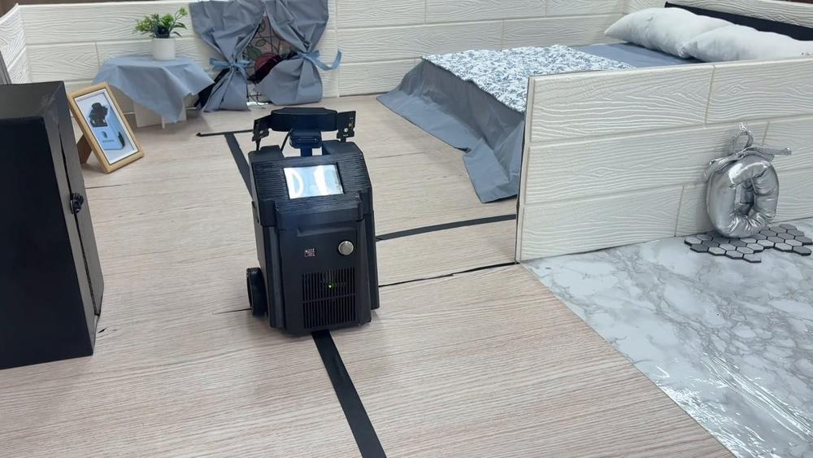
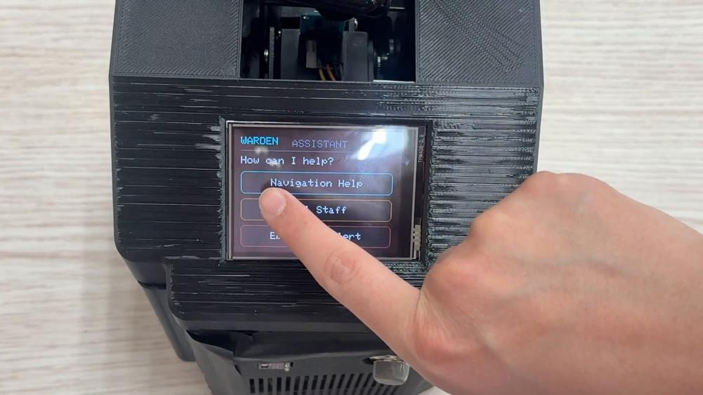

# WARDEN — Hotel Privacy Inspection Robot

**Inha University capstone · Team SPECTRA · 2026 · reviewed source snapshot**

WARDEN is a **research prototype** combining TurtleBot3 Burger, Raspberry Pi 4, ESP32 sensor hub, Logitech C920, tilt servo, ROS 2 Humble, and an inspection dashboard. It was demonstrated as a team engineering project; this repository represents a **cleaned, safety-reviewed reconstruction** from the recovered final shared source files. **The cleaned build has not yet been validated end-to-end on the original hardware.**

## Physical prototype and evidence



*Actual WARDEN prototype photographed from the team’s Taiwan presentation video during a controlled room-layout demonstration. The floor markings are part of the test environment; the image alone does not establish autonomous navigation or detection accuracy.*



*Actual touchscreen interaction from the team’s recorded demonstration. The recovered firmware sends guest events to a local dashboard; the image does not establish an external staff-dispatch integration.*

**[Watch the 25-second WARDEN demonstration preview](assets/video/warden_demo_preview.mp4)** — real prototype footage showing room-test movement and the TFT interface, with silent captions; it does not substantiate detection accuracy. The project owner reports that the team has approved public sharing of the included source, prototype photos, and edited demonstration video. For source-video inventory, slide references, historical trial figures and differences between presentation claims and recovered code, see [Presentation evidence and provenance](docs/PRESENTATION_EVIDENCE.md) and [Media release checklist](docs/MEDIA_RELEASE.md). The five unedited source MP4 clips remain in the team's Taiwan PowerPoint and are not included in the repository.

## Components

```text
  Android gamepad -> ROS2 /joy -> warden_teleop -> /cmd_vel -> TurtleBot3 OpenCR
                                   ^
                      /warden/scan_active (pause interlock)
                                   |
  C920 webcam -> WARDEN Python host / Flask dashboard (:8000)
                                   |
                      ESP32 serial PING/ENV/THERMAL/RF/EVENT/SERVO/LED/STATUS
                                   |
          BME280 · AMG8833 · MQ135 ADC · Wi-Fi scan · TFT · servo · status LED
```

## Engineering contributions

**Zahrokhon Kodirova — hardware integration, sensing software, inspection pipeline, and testing**

- **Hardware lead:** personally assembled, wired, connected, and troubleshot the Raspberry Pi, ESP32, camera, sensing modules, tilt servo/LED, and TFT hardware.
- **Sensor systems:** developed the ESP32 and Python integration for the **AMG8833 thermal array**, **BME280 temperature/humidity/pressure**, **MQ-135 raw analog gas reading**, and **Wi-Fi signal/RSSI monitoring**.
- **Detection and dashboard:** implemented the camera-based optical glint-detection design, multi-sensor inspection/data fusion software, environmental monitoring, and real-time local Flask dashboard.
- **Guest-assistant interface:** implemented a **TFT LCD prototype** with Navigation Help, Call Staff, and Emergency Alert selections reflected in the local dashboard. This was a proof-of-concept interface, **not** a fully deployed virtual assistant or external hotel-staff notification system.
- **Testing:** responsible for the hands-on sensor, wiring, software integration, and prototype troubleshooting/testing.

**Other teammates' work:** TurtleBot3 base movement and joystick driving; automatic program startup and ready/celebration spins; the 3D model. WARDEN was a **Team SPECTRA** project, and these aspects are not attributed to Zahrokhon Kodirova.

See [Detailed contributions and attribution](docs/CONTRIBUTIONS.md) for implementation details, collaborators' roles, and the distinction between historical prototype behavior and the cleaned source. **Implemented algorithms are not necessarily fully enabled or hardware-validated in the last saved configuration** (see the [recovery audit](docs/RECOVERY_AUDIT.md)).

## What is real, what is unavailable

- **No generated or random telemetry.** ESP32 reads actual sensor APIs; missing/failed readings appear unavailable (`null`/blank), not substituted values.
- **Thermal:** requires functioning AMG8833; host now reads the firmware's `THERMAL` response. Unplugged -> unavailable.
- **Environment:** BME280 readings are direct; MQ135 value is raw ADC (not ppm). Connectivity of the analog probe cannot be inferred from an ADC number alone.
- **RF:** nearby Wi-Fi access-point RSSI readings, not a dedicated hidden-camera RF detector.
- **Camera inspection:** captures real C920 frames at actual servo angles. Optional LED differential optical layer is **off until power verified**. Remote AI vision is **disabled by default** to protect room privacy. It requires explicit `WARDEN_ENABLE_AI=1`, a valid API key, consent, and network access. If unavailable, the verdict is `INCONCLUSIVE`.
- **Driving:** exactly one ROS velocity publisher (teleop); host triggers scans and interlocks motion. Celebratory spins are disabled by default for safety.
- **Line follower:** retained as an optional experimental ROS package, not enabled by the normal startup.

## Layout

- `firmware/warden_sensor_hub/` — ESP32 Arduino sketch, `EVENT` support and sensor fault handling
- `src/warden_host.py` — Flask dashboard, serial client, webcam and inspection
- `src/warden_teleop.py` — ROS joystick teleoperation and scan safety interlock
- `ros/drive_only.launch.py` — motor driver without LiDAR
- `scripts/` and `deploy/systemd/` — explicit ROS Humble service deployment
- `experimental/warden_line_follow/` — separate, unverified line-following experiment
- `docs/RECOVERY_AUDIT.md` — reconstructed changes and original engineering limitations
- `docs/HARDWARE_VERIFICATION.md` — required preflight/hardware tests

## Reproducibility (Raspberry Pi Ubuntu + ROS Humble)

1. Verify the ESP32 firmware wiring and hardware against `docs/HARDWARE_VERIFICATION.md`. **Never flash blindly.**
2. Install ROS 2 Humble, TurtleBot3 packages, joystick driver and platform system packages (including `python3-opencv` and `python3-rclpy`).
3. Create a virtual environment with ROS system packages visible: `python3 -m venv --system-site-packages .venv` and `.venv/bin/pip install -r requirements.txt`.
4. Create a local private environment file from `config/warden.env.example` at `~/.config/warden/warden.env`. Set correct serial port. Never commit secrets. The default dashboard binds **localhost only**; use a firewall/SSH tunnel for remote viewing.
5. After hardware checks, on the Pi run `bash scripts/install_services.sh` to **install but not start** four services. Start/test in stages, observe logs, and validate the emergency stop.
6. Use `python3 -m unittest discover -s tests -v` for offline logic checks.

## Limitations and responsible claims

This is a capstone demonstrator, **not a validated surveillance-detection or emergency-response product**. The reviewed host never transmits camera frames to remote AI by default; local captures remain sensitive test material. Touchscreen requests are shown on a local dashboard, not sent to hotel staff. Vision scores are heuristic, and historical quantitative test results have not been reproduced. Source audit and static checks are not substitutes for hardware integration tests.

Project was collaborative; this source package integrates team artifacts and preserves their provenance. No private keys, original SD images, or visitor camera captures are included.

## Publication status

The project owner confirms that the collaborating team approved public sharing of the included source code, selected prototype stills, and silent edited demonstration. This repository documents a **university research prototype** and a subsequently cleaned source version; the cleaned build remains **unverified end-to-end on the original hardware**. Historical detection benchmarks are not independently reproduced. There is no open-source `LICENSE` file: viewing a public GitHub repository does not grant permission to reuse or redistribute its code or media.
